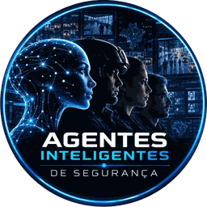

# Harness MEDIR para segurança eletrônica

**Derivado do harness MEDIR, de Teco Sodré: [github.com/tecosodreaboutdigital/harness-medir](https://github.com/tecosodreaboutdigital/harness-medir)** (série completa em [tecosodreaboutdigital.github.io/harness-medir](https://tecosodreaboutdigital.github.io/harness-medir/)).

*Leia em [English](README.en.md) · [Español](README.es.md). Site: [tecosodreaboutdigital.github.io/harness-medir-seguranca](https://tecosodreaboutdigital.github.io/harness-medir-seguranca/), em português, inglês e espanhol.*

O ciclo MEDIR aplicado ao CFTV e ao monitoramento: modelos de uma página, regras de nível de controle e casos anonimizados para quem vai colocar IA dentro de uma central de segurança sem entregar a decisão à máquina.

Este repositório nasceu na Oficina Prática de IA na Segurança, apresentada por Teco Sodré na SegSummit em 21 de outubro de 2026, e é construído em conjunto com a [comunidade A.I.S.](#comunidade-ais).

Estado: v0.2, primeira expansão: site em três idiomas e sete skills para agentes. Veja o [CHANGELOG](CHANGELOG.md).

---

## A ideia em uma linha

**Agente = modelo + harness.** O modelo é o que vê e escreve. O harness é tudo o que fica em volta dele: o contexto, as regras, quem decide, o que é medido e o que muda depois de um erro.

Trocar de modelo é fácil, e todo mundo tem acesso aos mesmos modelos. O harness é o que torna a IA confiável na sua operação, e é a parte que ninguém vende pronta.

Três frases resumem o resto do repositório:

1. **Todo alerta é uma hipótese, nunca uma prova.** O algoritmo aponta, o protocolo decide.
2. **O operador confirma.** Ação difícil de desfazer passa por gente, sempre.
3. **Sem verificação não existe autonomia responsável.** Se não há como conferir o alerta, nada é delegado.

---

## Derivado de harness-medir

Este projeto é derivado de [harness-medir](https://github.com/tecosodreaboutdigital/harness-medir), a série de Teco Sodré sobre engenharia de harness e o ciclo MEDIR (Mapear, Equipar, Delegar, Inspecionar, Reforçar). O método, a regra de dimensionamento e a ideia de que a falha vira mudança permanente no ambiente vêm de lá.

O que é diferente aqui:

| Aspecto | harness-medir | Este repositório |
|---|---|---|
| Domínio | Agentes de IA em geral | CFTV, monitoramento e segurança eletrônica |
| Formato | Série de artigos em HTML, guia compacto e playbook | Site curto em HTML, modelos e casos em Markdown e skills para agentes, para usar no dia seguinte |
| Idiomas | Português, inglês e espanhol | Site e README em português, inglês e espanhol; modelos, casos e skills em português |
| Escala de autonomia | Faixas N0 a N3 | Nível de controle N1, N2, N3 e Trava, aplicado por câmera, evento e decisão |
| Sem verificação | Teto de faixa | **Trava**: nada é delegado até existir um jeito de conferir o alerta |
| Quem escreve | Autor único | Comunidade, por issue ou pull request, com anonimização obrigatória |

A Trava é mais dura que o teto da origem por um motivo de domínio: na segurança, o custo de um alerta que ninguém consegue conferir recai sobre uma pessoa abordada, um acesso bloqueado ou uma operação parada.

Correspondência com o playbook da origem, para quem quiser se aprofundar: o [contrato de tarefa](modelos/contrato-de-tarefa.md) segue `playbook/task-contract.md`; o [nível de controle](modelos/nivel-de-controle.md) adapta `playbook/risk-matrix-by-tier.md` e `playbook/tier-diagnostic.md`; o [registro mínimo](modelos/sensores.md#registro-mínimo-de-cada-alerta) segue a ideia de `playbook/execution-receipt.md`.

---

## O ciclo MEDIR no CFTV

| Passo | Pergunta | No CFTV | Detalhe |
|---|---|---|---|
| **Mapear** | Que tarefa, com que risco? | Uma câmera, um evento, uma decisão. Quem decide hoje, quanto custa um falso positivo e um falso negativo, quantas vezes por mês acontece, o que nunca pode acontecer. Sai daqui o nível de controle. | [mapear.md](medir/mapear.md) |
| **Equipar** | O que o modelo precisa saber e poder fazer? | Papel, protocolo da central, nível de controle, formato da resposta, o que ele não sabe. Ferramentas mínimas: consultar o sistema de gravação, abrir chamado. | [equipar.md](medir/equipar.md) |
| **Delegar** | Quanto ele pode fazer sozinho? | Autonomia declarada por caso de uso, nunca por fornecedor. Placa clonada e rosto humano não têm o mesmo nível. Ação difícil de desfazer passa por gente. | [delegar.md](medir/delegar.md) |
| **Inspecionar** | Como sabemos que está funcionando? | Sensores que produzem evidência, não opinião: falsos positivos a cada mil alertas, tempo até a triagem, alertas por operador por hora, discordâncias registradas. | [inspecionar.md](medir/inspecionar.md) |
| **Reforçar** | O que muda depois de um erro? | Cada erro vira mudança permanente no ambiente (regra, limiar, zona mascarada, treino), com data e versão. Nunca só um conserto pontual. | [reforcar.md](medir/reforcar.md) |

Regra de dimensionamento, herdada da origem: **o harness precisa ser menor que a superfície de falha que ele controla.** Um processo de aprovação que dá mais trabalho que o próprio risco não sobrevive ao primeiro plantão.

---

## Nível de controle, em resumo

Aplique em ordem. A primeira linha verdadeira define o nível; a Trava, se valer, passa por cima de todas.

| Se... | Nível | Quem decide |
|---|---|---|
| quando o alerta dispara, alguém age no mundo real de um jeito difícil de desfazer | **N3** | A IA aponta; o operador confirma no vídeo e outra pessoa autoriza a ação. |
| o sistema lê ou grava em sistema de outra empresa ou do cliente, ou o evento passa de 100 por mês, ou a ação tem efeito fora da central | **N2** | A IA aponta e recomenda; o operador confirma antes de agir. |
| a ação é interna, fácil de desfazer e sem integração com terceiros | **N1** | A IA pode agir sozinha, sempre com registro. |
| não existe jeito de conferir se o alerta estava certo | **Trava** | Ainda não delegue nada. Primeiro crie a verificação. |

**N mais alto significa mais controle humano, não mais liberdade para a máquina.** A tabela completa, com exemplos e a matriz de ações, está em [modelos/nivel-de-controle.md](modelos/nivel-de-controle.md).

---

## Comece em 15 minutos

Escolha uma câmera real da sua operação e siga os passos. Não precisa instalar nada.

1. **Minutos 0 a 3. Mapear.** Escreva em uma frase: câmera, evento, decisão. Responda as quatro perguntas de [nível de controle](modelos/nivel-de-controle.md#as-quatro-perguntas) e anote o nível e a linha da tabela que o definiu.
2. **Minutos 3 a 6. Contrato.** Preencha o [contrato de tarefa](modelos/contrato-de-tarefa.md). Os campos que você não souber responder são a sua lista de pendências.
3. **Minutos 6 a 11. Equipar.** Monte um alerta fictício e rode lado a lado o prompt A (modelo puro) e o prompt B (modelo + harness) de [prompt-com-harness.md](modelos/prompt-com-harness.md). Pergunte: qual resposta você entrega ao seu operador às 3 da manhã?
4. **Minutos 11 a 14. Antes de ligar.** Passe o [checklist de 10 itens](modelos/checklist-antes-de-ligar.md). Todo "não" vira pendência com dono.
5. **Minuto 15. Inspecionar.** Escolha dois [sensores](modelos/sensores.md) para começar a medir amanhã. Falsos positivos por mil alertas e alertas por operador por hora são um bom par inicial.

---

## Arquivos

**Site (GitHub Pages, pasta `docs/`)**

- [docs/index.html](docs/index.html): página inicial em português, com [inglês](docs/en/index.html) e [espanhol](docs/es/index.html)
- Uma página por passo do ciclo, uma de [modelos](docs/modelos.html) e uma de [skills](docs/skills.html), em cada idioma
- HTML e CSS estáticos, sem JavaScript; a única dependência externa são as fontes IBM Plex do Google Fonts, com fonte do sistema como reserva

**Skills para agentes**

- [skills/README.md](skills/README.md): catálogo, instalação e regras comuns
- [mapear-camera](skills/mapear-camera/SKILL.md): entrevista e contrato de tarefa com nível de controle
- [triagem-de-alerta](skills/triagem-de-alerta/SKILL.md): o prompt com harness, no formato A a E
- [revisar-nivel-de-controle](skills/revisar-nivel-de-controle/SKILL.md): auditoria de uma operação já ligada
- [integracao-vms](skills/integracao-vms/SKILL.md): alertas do sistema de gravação por ONVIF, REST ou webhook, somente leitura, com servidor mock
- [integracao-controle-de-acesso](skills/integracao-controle-de-acesso/SKILL.md): webhook somente leitura de controle de acesso e RH, com notas de LGPD para biometria
- [saude-da-operacao](skills/saude-da-operacao/SKILL.md): selo de integridade do dado (íntegro, estimado, atrasado, sem dado)
- [mcp-central](skills/mcp-central/SKILL.md): desenho de servidor MCP com três ferramentas e o harness em volta

**O ciclo, passo a passo**

- [medir/mapear.md](medir/mapear.md)
- [medir/equipar.md](medir/equipar.md)
- [medir/delegar.md](medir/delegar.md)
- [medir/inspecionar.md](medir/inspecionar.md)
- [medir/reforcar.md](medir/reforcar.md)

**Modelos para copiar**

- [modelos/contrato-de-tarefa.md](modelos/contrato-de-tarefa.md): uma página para uma câmera, um evento e uma decisão
- [modelos/nivel-de-controle.md](modelos/nivel-de-controle.md): N1, N2, N3 e Trava, aplicados em ordem
- [modelos/prompt-com-harness.md](modelos/prompt-com-harness.md): prompt A e prompt B, e como comparar os dois
- [modelos/checklist-antes-de-ligar.md](modelos/checklist-antes-de-ligar.md): dez itens antes de ligar um analítico novo
- [modelos/sensores.md](modelos/sensores.md): métricas que produzem evidência e o registro mínimo de cada alerta

**Casos**

- [casos/README.md](casos/README.md): como ler e como enviar um caso
- [casos/_modelo.md](casos/_modelo.md): modelo de caso, com checklist de anonimização
- Quatro casos de exemplo, em nível de setor: [indústria](casos/01-industria-efetivo-por-area.md), [terminal de granéis](casos/02-terminal-de-graneis-evidencia.md), [sites remotos de energia](casos/03-sites-remotos-de-energia.md), [grandes eventos](casos/04-grandes-eventos.md)

**Projeto**

- [CONTRIBUTING.md](CONTRIBUTING.md): como contribuir e regras de anonimização
- [CHANGELOG.md](CHANGELOG.md): histórico de versões
- [LICENSE](LICENSE): texto legal da CC BY 4.0

---

## Comunidade A.I.S.

**A.I.S. 🚀 Agentes de IA = Modelo + Harness para Segurança Eletrônica, Monitoramento e Produtividade**

Uma comunidade no WhatsApp sobre este tema, para quem opera, regula, audita ou constrói soluções digitais inteligentes. É lá que aparecem os casos, as dúvidas e os erros que depois viram regra neste repositório. No grupo vale a mesma regra de anonimização do repositório.

**[Entrar na comunidade A.I.S. no WhatsApp](https://chat.whatsapp.com/FlXr6KUllRpCkjJz16uZYY)**

 

---

## Como contribuir

Este repositório cresce com o que acontece nas operações de quem participa. Cinco tipos de contribuição são bem-vindos:

1. **Um caso real**, anonimizado, no [modelo de caso](casos/_modelo.md).
2. **Um erro que virou regra**: o que deu errado e qual mudança permanente entrou no ambiente.
3. **Um sensor** que produziu evidência na sua central.
4. **Uma skill**, com a seção de harness obrigatória (veja [CONTRIBUTING.md](CONTRIBUTING.md#uma-skill)).
5. **Uma pergunta, correção ou tradução** sobre qualquer arquivo.

O fluxo (issue ou pull request) e as regras de anonimização estão em [CONTRIBUTING.md](CONTRIBUTING.md). Nenhum nome de cliente, cidade, órgão, fornecedor, modelo de equipamento ou preço entra no repositório.

---

## Autoria

Método MEDIR e série de origem: Teco Sodré, em [harness-medir](https://github.com/tecosodreaboutdigital/harness-medir).

Adaptação para segurança eletrônica: Teco Sodré, WeSAFER e AVANTIA, com as contribuições da comunidade registradas no histórico do repositório.

---

## Licença

Conteúdo sob [CC BY 4.0](https://creativecommons.org/licenses/by/4.0/deed.pt-br) (Creative Commons Atribuição 4.0 Internacional). © 2026 Teco Sodré, WeSAFER e AVANTIA.

Você pode usar e adaptar este material, inclusive comercialmente, desde que cite a fonte. O texto legal completo está em [LICENSE](LICENSE).

Este repositório é derivado de [harness-medir](https://github.com/tecosodreaboutdigital/harness-medir), cujos artigos originais seguem com os termos do repositório de origem.
